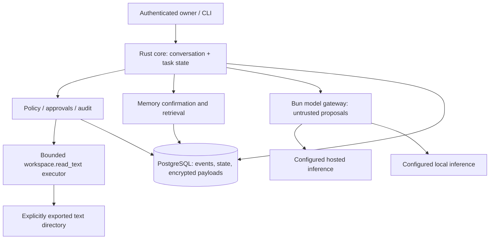

# Proposed modular architecture

## First deployment

One host, three runtime components: Rust `jarvis-core`, Bun `model-gateway`, and
PostgreSQL. A Rust CLI is the initial client. Modules remain in one core service;
do not create a microservice per subsystem, message broker or separate vector DB.

The gateway transports model input/output; it cannot execute tools, approve actions,
write memory, access the database or mount the exported workspace. The Rust core
owns authorization, dispatch and durable transitions. Initially it also performs
the one bounded read operation. Future isolated adapter workers perform operations
under a core-issued execution envelope; they do not become policy authorities.

## Core component boundaries

| Module | Owns | Must not own |
| --- | --- | --- |
| Conversation | Input context, generation, tool-result continuation | Permission creation or unvalidated model actions |
| Task runtime | State machine, deadlines, leases, retries, cancellation | Unlimited model loops or blind external retries |
| Policy | Owner-authenticated grant issuance, revocation, dispatch checks | Trust decisions delegated to the model |
| Tool registry/executor | Versioned schema, resource resolution, limits, observed outcome | Arbitrary shell or provider-owned execution |
| Memory | Candidate/confirmation, scoped retrieval, supersession, erasure | Turning model confidence into confirmed facts |
| Event store | Atomic transitions, metadata event order, payload references | Raw secrets or copied private text in audit metadata |
| Model gateway | Transport normalization, cancellation, usage, capability errors | Workspace/DB access, grants or security decisions |
| Client protocol | Authenticated commands, replay cursor, exact approval presentation | Implicit authorization from conversation text |

## Data and trust flow

1. Authenticate owner and session; record an idempotent input command and generation.
2. Retrieve authorized confirmed memory and construct bounded model context. Label
   documents and tool content as untrusted observations; this is defense in depth,
   not the authorization mechanism.
3. Core requests inference with a deadline, output limit, approved provider and
   explicit tool schemas. Gateway streams provider-neutral events.
4. Core accepts a tool proposal only after complete, schema-valid arguments arrive.
   Persist pending proposal; show exact scope, path, provider disclosure and expiry.
5. Owner separately grants through the authenticated approval endpoint. Core
   atomically consumes the grant and records execution intent before dispatch.
6. Resolve/open approved resource safely; enforce limits; commit observed outcome
   only for the current generation and lease fence. Return actual result to model.
7. Persist final response and checkpoint. A response is provisional until committed;
   disconnected clients recover committed events by cursor.

## Durable task state

Task states: `queued`, `running`, `waiting_approval`, `waiting_provider`,
`waiting_review`, `succeeded`, `failed`, `cancelled`. A running task's checkpoint
names its next step; steps have `planned`, `authorized`, `dispatched`, `completed`,
`failed`, `outcome_unknown` statuses. Execution outcome is separate from task
cancellation: stopping interest in a result does not undo an action already begun.

Persist tasks, steps, encrypted messages/payloads, grants, memory records,
confirmations and content-free events in PostgreSQL. Use unique owner/request IDs
for input deduplication, task versions for compare-and-swap, and step execution
IDs for dispatch deduplication. Checkpoints reference payloads instead of copying
private content. Persist state transition + event + execution intent in one
transaction; do not hold DB locks while waiting on the owner or a provider.
PostgreSQL supports row locks, which inform this choice; the application still
must enforce its invariants. [PostgreSQL locking](https://www.postgresql.org/docs/current/explicit-locking.html)

One worker initially; leases and monotonic fencing prevent a restarted or stale
worker from committing. On lease takeover increment fence. Before dispatch, recheck
grant expiry/revocation/policy version and cancellation in the same authorization
transition. Recovery cannot renew grants. A consumed grant with a committed result
reuses that result; a dispatched read lacking a result moves to `waiting_review`
and needs fresh approval to reread. A nondispatched authorized read also requires
fresh approval after restart. This conservative policy avoids hidden permission
reuse and reads from changed resources.

No external exactly-once guarantee is proposed. Later external adapters require
an idempotency key or a reconciliation endpoint; otherwise uncertain outcomes
pause for review. An outbox is added only when an actual worker dispatch boundary
needs it. Events are polled by cursor initially, with notifications as hints.

## Memory, privacy and retrieval

Semantic records contain owner/scope, structured key/value, epistemic status
(`confirmed`, `inferred`, `uncertain`), source references, timestamps, retention
and supersession. Only exact-content user confirmation enables durable confirmed
semantic recall. Model-generated candidates remain pending; memory writes and
deletes use authenticated owner commands and transactional audit records.

Use application encryption for private payloads, with keys outside DB storage and
backups. Initial recall is bounded exact-key lookup via an owner-scoped HMAC key
index, followed by decryption. Avoid a plaintext full-text index over encrypted
private memories. Later ranking can decrypt a bounded candidate set in memory;
benchmark opt-in non-sensitive full-text search and vector alternatives separately.
Working context is bounded; episodes, procedures and project records follow in
Phase 2 rather than pretending all memory types are implemented in Phase 1.

Events are append-only metadata without private bodies. Encrypted payload records
can be deleted; tombstones and source-message erasure prevent rehydration. Backups
retain deleted ciphertext until declared expiry; restoration applies the surviving
erasure ledger before serving requests. Do not claim instantaneous backup erasure
or cryptographic shredding when wrapped keys survive in a backup.

## Degraded operation

Provider unavailable: memory inspection, grant revocation, cancellation, local
read results and task status still work. Automatic inference fallback uses only
already approved providers within the same data-egress policy and budget. No
silent transfer of local-only content to a hosted provider. If none qualify,
persist `waiting_provider` and show an actionable failure rather than an invented
answer. A DB or encryption-key outage fails closed for tools and private payloads.

## Later extension boundaries

Voice sessions carry timestamped chunks and generation IDs; barge-in stops local
playback and invalidates model generation before awaiting network cancellation.
Vision capture uses explicit leases and retained-media settings. Agents inherit
the intersection of parent grants and specialist scope plus independent budgets.
Android/desktop/web clients use the same protocol; device pairing and remote TLS
must precede any non-loopback service. Proactivity consumes configured sources
with persistent deduplication, quiet hours and revocable action grants.
